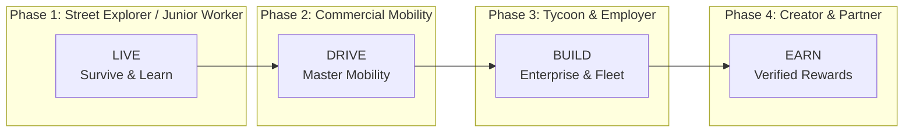

# PROJECT EKO — MASTER CONTEXT & STRATEGIC VISION

> **"Build a city where every road can become a story, and every story can become a livelihood."**
> 
> # **LIVE. DRIVE. BUILD. EARN.**

---

## 1. Executive Summary & Core Thesis

**Project Eko** is a browser-first (WebGL/WebGPU), persistent-feeling, multiplayer African urban simulation. 
Players enter a living, authentic representation of **Lagos, Nigeria**, where they build a career, master vehicle dynamics across chaotic transport corridors, operate businesses, socialize in culturally resonant hubs, and participate in a verified, non-wagering real-economy reward ecosystem.

### The Differentiation Mandate (Anti-Clone Invariant)
**We do not copy *Lagos Life*.** 
*Lagos Life* demonstrated that deep cultural familiarity—familiar slang, local food, recognizable road intersections, yellow Danfo buses, and everyday Nigerian humor—dramatically lowers the psychological barrier to entry for digital entertainment. 

However, Project Eko refuses to be a shallow cosmetic sandbox or a static life simulator. Instead, it evolves that cultural insight into a **player-driven, system-rich economic world** where mobility, mechanical skill, market negotiation, and commercial enterprise are the primary engines of progression.

```
       [ LAGOS LIFE BASELINE ]                     [ PROJECT EKO AMBITION ]
  • Casual sandbox life simulator             • Persistent economic & mobility engine
  • Cosmetic driving & transport               • Weighted physics, fleet & logistics enterprise
  • Monolithic virtual coins                   • Hard-isolated Dual Economy (Simulation vs. Real AP)
  • Generic UI & ad-heavy aesthetic            • Sleek in-game OS ("EkoPhone"), clean HUD, immersion
  • Closed mini-game loops                     • Mini-games that feed actual careers & market power
```

---

## 2. The Product Promise: LIVE. DRIVE. BUILD. EARN.

Every player's journey follows a deliberate, empowering economic arc:



1. **LIVE**: You spawn into a vibrant, high-density Lagos district (e.g., Marina/CMS, Yaba, or Oshodi). You establish your identity, secure shelter, manage living costs (food, rent, power), interact with NPC neighbors, and take on entry-level jobs (junior clerk, apprentice mechanic, market loader).
2. **DRIVE**: Mobility is power in Lagos. You take driving lessons, pass a rigorous driving test, buy your first beaten-down compact car, navigate notorious traffic choke points, learn the back streets, and begin passenger ride-hailing or dispatch delivery.
3. **BUILD**: You graduate from solo driver to fleet entrepreneur. You buy a 14-seater Danfo bus, hire an NPC or player conductor, manage route schedules, purchase a repair garage in Tejuosho, lease delivery vans in Ikeja, and acquire commercial property.
4. **EARN**: Under a strictly regulated, non-wagering architecture, your proven skills and business reach unlock legitimate brand sponsorships, skill tournament prizes, creator revenue-shares, and commercial affiliate commissions paid out directly via licensed Payment Service Providers (PSPs).

---

## 3. The Ten Master Bibles (The Pre-Build Architecture)

Before writing the first line of simulation code, the development team must operate against 10 immutable specifications:

| # | Master Document | Purpose & Scope |
| :--- | :--- | :--- |
| **01** | **Master PRD** | Complete product requirements, personas, 5 core loops, retention engine, and North Star metrics. |
| **02** | **Lagos World Bible** | Geospatially anchored district catalogue: roads, landmarks, LAMATA transit spine, NPC routines, commercial zones. |
| **03** | **Vehicle & Physics Bible** | Longitudinal/lateral vehicle dynamics, gearboxes, weight transfer, Danfo payload, rain modifiers, damage, wear. |
| **04** | **Lagos Culture Bible** | Language, street vocabulary, food, fashion, soundscapes, owambe, generator culture, area boy dynamics, authenticity. |
| **05** | **Gameplay & Mini-Games** | Skill-based mechanics that feed career trees: Driving Test, Conductor Memory, Mechanic Bay, Market Bargaining, 5v5 Football. |
| **06** | **Player Economy Bible** | Virtual economy constitution: Game Naira, double-entry ledger, sinks/sources, asset depreciation, supply/demand. |
| **07** | **Real-Reward & Compliance** | Anti-gambling boundary, accounts-payable architecture, cryptographic evidence packages, fraud heuristics, PSP rails. |
| **08** | **Multiplayer & Social Spec** | Zone sharding (32–64 CCU), 20–30 Hz tick snapshots, client interpolation, crews, trade partnerships, moderation. |
| **09** | **World Asset & IP Bible** | Rights-aware asset matrix: real geography vs. inspired landmarks vs. fictional brands vs. licensed commercial placements. |
| **10** | **Antigravity Build System** | Monorepo architecture, specialized AI agent roles, ADR sequence, automated test suites, delivery milestones. |

---

## 4. The Antigravity Agent Guild

The development of Project Eko is executed by specialized AI subagents adhering to strict role boundaries:

```
                      [ ARCHITECT ]
                            │
      ┌─────────────────────┼─────────────────────┐
      │                     │                     │
[ WORLD_BUILDER ]     [ VEHICLE_SIM ]       [ REALTIME ]
(OSM, Mesh, Districts) (Handling, Physics)   (Zones, WebSockets)
      │                     │                     │
[ GAMEPLAY ]          [ ECONOMY ]           [ REWARDS_RISK ]
(Careers, Mini-games) (Double-Entry Ledger) (Anti-Fraud, AP Engine)
      │                     │                     │
[ ART_ASSET ]         [ PAYMENTS ]          [ QA_BROWSER ]
(Models, IP Matrix)   (PSP Adapters)        (DevTools, E2E Replay)
                            │
                      [ SECURITY ]
                   (Threat Modeling)
```

---

## 5. Architectural Invariants (Non-Negotiables)

1. **Hard Two-Economy Boundary**: Virtual Game Naira is never convertible to real fiat currency. Real rewards flow exclusively from external sponsor/commerce budgets through accounts-payable workflows.
2. **Zero Gambling Mechanics**: No player-vs-player staking, no wager-to-win, no random lottery draws for cash, no in-game stored-value consumer wallet.
3. **Server-Authoritative Truth**: The browser client is an untrusted rendering surface. All economic mutations, race completions, and reward evidence packages are calculated, signed, and validated server-side.
4. **Idempotency & Auditability**: Every balance mutation is a balanced double-entry transaction tied to an immutable event ID and reversible only through auditable compensating ledger entries.
