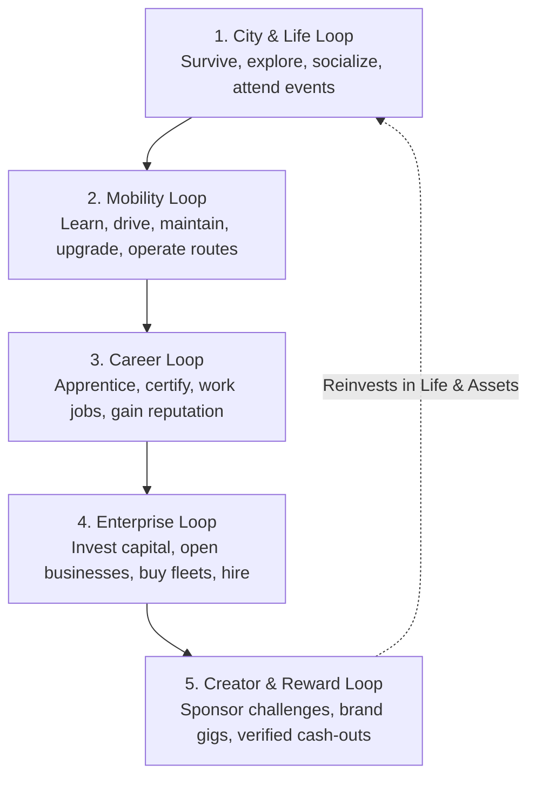

# DOCUMENT 01 — PROJECT EKO MASTER PRD
## Product Requirements Document: The Living African Urban Simulator

> **Mantra: LIVE. DRIVE. BUILD. EARN.**  
> **Status**: Approved Master Specification  
> **Target Release Window**: Q1/Q2 2027  
> **Target Platform**: Browser-First WebGL/WebGPU (Desktop & Mobile Chrome/Safari)  

---

## 1. Product Vision & Positioning

### 1.1 Vision Statement
Project Eko is an open-world, persistent-feeling multiplayer city simulation grounded in the cultural, physical, and commercial reality of Lagos, Nigeria. It provides players with an authentic canvas to rise from an unranked street resident to a transport mogul, corporate executive, or celebrated creator, backed by physical vehicle handling, deep economic enterprise, and a legally compliant, non-wagering real-reward framework.

### 1.2 Target Personas
```
┌─────────────────┬──────────────────────────────────────────┬────────────────────────────────────────┐
│ Persona         │ Psychological Drive & In-Game Goals      │ Monetizable / Commercial Path          │
├─────────────────┼──────────────────────────────────────────┼────────────────────────────────────────┤
│ Street Explorer │ Immersion, comedy, social hangouts,      │ Sponsored real-world brand events,     │
│                 │ discovering landmarks, lifestyle avatar. │ cosmetics, branded venues & clubs.     │
├─────────────────┼──────────────────────────────────────────┼────────────────────────────────────────┤
│ Master Driver   │ Physics mastery, vehicle tuning, bus     │ Sponsor-funded safe-driving challenges │
│                 │ routes, street racing, towing contracts. │ and competitive time-trial leaderboards│
├─────────────────┼──────────────────────────────────────────┼────────────────────────────────────────┤
│ Tycoon / Hustler│ Profit, fleet management, logistics,     │ B2B sponsored businesses, commercial   │
│                 │ real estate, hiring drivers/workers.     │ storefronts, enterprise advertising.   │
├─────────────────┼──────────────────────────────────────────┼────────────────────────────────────────┤
│ Creator/Stylist │ Fashion curation, music staging, owambe  │ Creator revenue-share, branded capsule │
│                 │ event hosting, content production.       │ collections, event ticketing fees.     │
├─────────────────┼──────────────────────────────────────────┼────────────────────────────────────────┤
│ Diaspora Player │ Cultural reconnection, nostalgia, living │ Premium real estate, luxury vehicles,  │
│                 │ a virtual Lagos life from abroad.        │ cultural festival VIP passes.          │
└─────────────────┴──────────────────────────────────────────┴────────────────────────────────────────┘
```

---

## 2. The Five Interlocking Core Loops

Project Eko succeeds because its 5 core loops feed into one another seamlessly:



### Loop 1: The City & Life Loop (LIVE)
* **Explore $\rightarrow$ Encounter $\rightarrow$ Survive $\rightarrow$ Upgrade Lifestyle.**
* Players must manage living costs: rent on apartments (from single-room *Face-me-I-face-you* in Mushin to luxury high-rises in Ikoyi/Eko Atlantic), food (street puff-puff, mama-put amala, Victoria Island bistro meals), and utilities (NEPA grid status vs. generator fuel).
* Socializing in public squares (TBS, Freedom Park, beach clubs) builds network connections and unlocks insider business tips.

### Loop 2: The Mobility Loop (DRIVE)
* **Acquire $\rightarrow$ Commute $\rightarrow$ Master $\rightarrow$ Maintain $\rightarrow$ Scale.**
* Mobility is not an afterthought; it is the physical spine of the game. Walking is slow in a sprawling metropolis like Lagos. Players begin with public transit (BRT / Danfo / Okada) or ride-hailing, save for an entry sedan, experience realistic traffic bottlenecks, and use their vehicles to generate commercial income.
* Vehicles incur tyre wear, brake fatigue, oil depletion, and body damage from Lagos road hazards (potholes, reckless NPC traffic, flash floods).

### Loop 3: The Career Loop (WORK)
* **Learn $\rightarrow$ Certify $\rightarrow$ Perform $\rightarrow$ Rank Up $\rightarrow$ Specialize.**
* Professional progression is gated by verifiable skill credentials. Want to drive a commercial Danfo? You must pass the Commercial Driving Test. Want to repair vehicles? Complete the Mechanic Bay diagnostic challenges.
* High reputation scores unlock VIP corporate driver contracts, executive dispatch jobs, or wholesale market access.

### Loop 4: The Enterprise Loop (BUILD)
* **Save $\rightarrow$ Buy Assets $\rightarrow$ Hire Staff $\rightarrow$ Price Services $\rightarrow$ Compound.**
* Moving beyond personal labor into passive and managed enterprise. A player buys 3 Danfo minibuses, hires NPC or player drivers, sets ticket prices, and manages depot repairs.
* A player buys a Computer Village tech stall, sources wholesale phones/laptops from Alaba International Market, and sells at retail markups.

### Loop 5: The Creator & Reward Loop (EARN)
* **Compete / Create $\rightarrow$ Validate Telemetry $\rightarrow$ Sponsor Payout.**
* Verified, non-wagering campaigns funded by corporate advertisers (e.g., "Zenith Bank Eco-Driving Cup" or "MTN Fast Dispatch Marathon").
* Players meeting strict, server-verified objective metrics receive real monetary rewards processed through licensed payment rails.

---

## 3. Player Journey Lifecycle: The Hustler’s Arc

```
┌────────────────────────────────────────────────────────────────────────────────────────┐
│ LEVEL 1–5: ARRIVAL & STREET HUSTLE                                                    │
│ • Arrive at CMS or Oshodi bus terminal with ₦5,000 Game Naira in pocket.               │
│ • Commute on foot or board public Danfo / BRT buses.                                   │
│ • Take low-barrier jobs: Market porter at Balogun, dispatch runner on foot/keke.        │
│ • Rent a modest room in Mushin/Yaba; manage generator fuel and daily meals.            │
├────────────────────────────────────────────────────────────────────────────────────────┤
│ LEVEL 6–15: MOBILITY & INDEPENDENCE                                                   │
│ • Enroll in Driving School; master clutch, braking, and traffic navigation mini-games. │
│ • Buy first used compact hatchback (e.g., 'Eko City 1.2').                             │
│ • Register for in-game ride-hailing ('EkoRide') and package dispatch contracts.       │
│ • Upgrade tyres and brakes to handle rainstorms on Third Mainland Bridge.              │
├────────────────────────────────────────────────────────────────────────────────────────┤
│ LEVEL 16–30: COMMERCIAL OPERATOR                                                      │
│ • Pass Commercial Minibus Certification; acquire iconic yellow 14-seater Danfo bus.    │
│ • Run profitable commuter routes (Ojota $\rightarrow$ Ketu $\rightarrow$ Mile 12).     │
│ • Hire an NPC conductor or co-op with another player for passenger callout bonuses.    │
│ • Upgrade living space to a 2-bedroom flat in Surulere or Ikeja GRA.                   │
├────────────────────────────────────────────────────────────────────────────────────────┤
│ LEVEL 31–50: TYCOON & FLEET OWNER                                                      │
│ • Establish a registered transport company; own a depot in Oshodi with 5 buses.        │
│ • Purchase commercial real estate: a mechanic workshop in Tejuosho or boutique in VI.  │
│ • Form a business syndicate/crew with other players to corner wholesale trade.         │
│ • Move into luxury waterfront residential real estate in Lekki Phase 1 / Ikoyi.        │
├────────────────────────────────────────────────────────────────────────────────────────┤
│ ENDGAME: CREATOR, SPONSOR PARTNER & CITY LEGEND                                        │
│ • Host massive sponsored social events, music festivals, or street rallies.           │
│ • Qualify for high-tier brand-sponsored skill tournaments with real cash payouts.      │
│ • Launch custom fashion lines and branded vehicles via the Creator Studio.             │
└────────────────────────────────────────────────────────────────────────────────────────┘
```

---

## 4. In-Game Interface Architecture: The "EkoPhone"

Rather than cluttering the screen with immersion-breaking menus, all core player management is hosted within an in-game smartphone OS (**EkoPhone**), complemented by an ultra-clean **City HUD**:

```
[ MINIMAL CITY HUD (Driving / Walking) ]
┌─────────────────────────────────────────────────────────────────────────────────┐
│ [Compass / Minimap]               [Time / Weather]              [Speed / Gear]  │
│  Lekki-Ikoyi Link Bridge           18:45 • Heavy Rain            72 km/h • 4th  │
│                                                                  Fuel: 68%      │
│                                                                                 │
│ [Active Mission Banner]                                                         │
│ Deliver Corporate Documents to Victoria Island • ETA 4m 12s • Reward: ₦18,500   │
└─────────────────────────────────────────────────────────────────────────────────┘

[ EKOPHONE (Toggled via Hotkey / Tap) ]
┌──────────────────────────────────────┐
│  18:45                 📶 4G  🔋 88% │
│  EKO OS v1.0                         │
│ ┌─────────┐ ┌─────────┐ ┌─────────┐  │
│ │ EkoRide │ │ JobsHub │ │ EkoBank │  │
│ └─────────┘ └─────────┘ └─────────┘  │
│ ┌─────────┐ ┌─────────┐ ┌─────────┐  │
│ │ Garage  │ │ Market  │ │ Fleet   │  │
│ └─────────┘ └─────────┘ └─────────┘  │
│ ┌─────────┐ ┌─────────┐ ┌─────────┐  │
│ │ Social  │ │ Sponsor │ │ EkoMaps │  │
│ └─────────┘ └─────────┘ └─────────┘  │
│                                      │
│ ── NOTIFICATION ──────────────────── │
│ EkoBank: Salary credited +₦25,000 GN │
│ Danfo #03: Maintenance required      │
└──────────────────────────────────────┘
```

* **EkoRide**: Passenger hailing app (accept rides as driver or hail rides as passenger).
* **JobsHub**: Career classifieds, certifications, and daily contracts.
* **EkoBank**: Virtual Game Naira savings account, business loans, and property mortgages.
* **Garage**: Real-time telemetry on owned vehicles, repair booking, and tuning shop.
* **Market**: Buy/sell vehicle parts, electronics, clothing, and properties.
* **Fleet**: Fleet tracking, route management, ticket pricing, and driver payroll.
* **Sponsor / Rewards**: Separate, secured portal for sponsored challenges and payout history.

---

## 5. Retention & Virality Mechanics

### 5.1 Shareable "Flex Cards" & Media
Every milestone—passing your driving test, buying your first car, surviving a 100km/h aquaplaning drift across Third Mainland Bridge, or opening your first retail shop—auto-generates a dynamic, stylish Nigerian social card formatted for TikTok, Instagram Reels, and X (Twitter):
* Shows player avatar, vehicle stats, custom license plate, and achievement banner.
* One-click export to clipboard or native share sheet.

### 5.2 Cultural Event Calendar
The virtual city reflects the real rhythm of Lagos life:
* **Detty December**: High-intensity concert venues in Victoria Island, beach parties, surge pricing on taxi rides, and special Afrobeats radio playlists.
* **Independence Day Weekend**: Civic parades at TBS, street football tournaments, and national landmark lighting.
* **Rainy Season (June/July)**: Massive flash floods across low-lying roads (Oshodi, Marina), doubling breakdown rates and creating high demand for tow trucks and 4x4 SUVs.

---

## 6. Success Metrics & North Star KPI Tree

```
                               [ NORTH STAR KPI ]
                 30-Day Retained Active Economic Citizens (D30 RAEC)
                     (Players who log in $\ge 3$ days/week, drive $\ge 15$ km,
                      and complete $\ge 5$ economic transactions)
                                      │
       ┌──────────────────────────────┼──────────────────────────────┐
       │                              │                              │
[ ACQUISITION & ACTIVATION ]   [ ENGAGEMENT & DEPTH ]        [ ECONOMIC BALANCE ]
• Viral K-Factor (> 1.2)        • Average Session Time (> 22m)• Double-Entry Zero Discrepancy
• D1 Retention (> 45%)         • Km Driven / Session (> 12km) • Gini Wealth Coefficient (< 0.65)
• D7 Retention (> 25%)         • Fleet Ownership Rate (15%)   • Sink/Source Equilibrium Ratio
```
