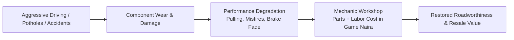

# DOCUMENT 03 — VEHICLE & PHYSICS BIBLE
## Automotive Dynamics, Handling Profiles & Fleet Engineering

> **Core Philosophy**: Vehicles in Project Eko are not floating arcade boxes. They possess weight, inertia, tyre slip angles, suspension travel, mechanical fatigue, and environmental sensitivity. Driving is a disciplined craft where road condition, vehicle payload, and driving skill dictate survival and profit.

---

## 1. Physics Engine Architecture & Simulation Model

The client runs a semi-authoritative physics simulation at **60 Hz** integrated into the Three.js render loop, with **20–30 Hz server validation checkpoints** on speed, acceleration limits, and collision impulses for anti-cheat verification.

```
       [ PLAYER INPUT (Steer, Throttle, Brake, Clutch, Handbrake) ]
                                    │
                                    ▼
       [ POWERTRAIN MODEL ] ──► Engine RPM, Torque Curve, Gearbox & Differential
                                    │
                                    ▼
       [ SUSPENSION & WEIGHT TRANSFER ] ──► Pitch (Dive/Squat) & Roll Angles
                                    │
                                    ▼
       [ TYRE GRIP & SURFACE MODEL ] ──► Slip Angle, Friction Circle (Pacejka)
                                    │
            ┌───────────────────────┴───────────────────────┐
            ▼                                               ▼
 [ DRY ASPHALT / NORMAL ]                       [ RAIN / POTHOLES / WET ]
```

### 1.1 Powertrain & Transmission Model
* **Engine Torque Curve**: Torque is calculated as a function of RPM using a normalized non-linear power curve:
  $$\tau_{\text{engine}} = \tau_{\text{peak}} \cdot \left[ 1 - \alpha \left(\frac{\text{RPM} - \text{RPM}_{\text{peak}}}{\text{RPM}_{\text{range}}}\right)^2 \right]$$
* **Gear Ratios**: Realistic 4-speed, 5-speed, 6-speed manual and automatic gearboxes with defined primary gear ratios and final drive differentials.
* **Clutch & Stall Dynamics**: On manual transmission vehicles (Danfo, manual taxis), releasing the clutch abruptly at low RPM without throttle stalls the engine, triggering hazard lights and requiring a restart sequence.
* **Fuel Consumption**: Modeled by engine displacement, instantaneous RPM, throttle position, and payload mass:
  $$\dot{V}_{\text{fuel}} = \beta \cdot \text{RPM} \cdot \text{Throttle} + \text{IdleRate}$$
  Aggressive stop-and-go driving through Oshodi traffic burns up to **300% more fuel** than smooth cruising along the Lekki-Ikoyi Link Bridge.

### 1.2 Suspension & Dynamic Weight Transfer
* **Spring & Damper Model**: Independent 4-wheel raycast suspension. Each wheel calculates:
  $$F_{\text{suspension}} = k \cdot (L_0 - L) - c \cdot \frac{dL}{dt}$$
  where $k$ is spring stiffness, $c$ is damping coefficient, $L_0$ is rest length, and $L$ is current compression.
* **Pitch (Dive & Squat)**: Heavy braking shifts normal force to the front axle ($\Delta F_z = m \cdot a_x \cdot h / L_{\text{wheelbase}}$), unloading the rear wheels and inducing rear-end instability.
* **Roll (Body Lean)**: Cornering induces centrifugal chassis roll based on center-of-mass height ($h_{\text{cg}}$). High-center-of-gravity vehicles (Danfo minibuses, commercial vans) run severe rollover risks if cornered sharply above 45 km/h.

### 1.3 Tyre Dynamics & The Friction Circle (Pacejka Lite)
Tyre grip is governed by a modified Pacejka formulation balancing longitudinal traction ($F_x$) and lateral cornering force ($F_y$):
$$F_{\text{total}} = \sqrt{F_x^2 + F_y^2} \le \mu_{\text{surface}} \cdot \mu_{\text{tyre}} \cdot F_z$$
* If the player brakes hard while turning without ABS, $F_x$ saturates the friction circle, causing immediate understeer ($F_y \to 0$) and plowing straight ahead.
* **Tyre Wear Factor**: Worn tyres reduce $\mu_{\text{tyre}}$ from 1.0 (new sport tyre) down to 0.42 (bald commercial tyre), dramatically lengthening braking distances.

---

## 2. Environmental & Surface Modifiers

Lagos roads are notoriously diverse, ranging from smooth tolled expressways to cratered residential bypasses:

```
┌────────────────────┬─────────────┬──────────────┬──────────────────────────────────────────────────┐
│ Surface Type       │ Dry Coeff μ │ Wet Coeff μ  │ Dynamic Road Effects                             │
├────────────────────┼─────────────┼──────────────┼──────────────────────────────────────────────────┤
│ Smooth Asphalt     │ 0.95        │ 0.65         │ High stability, minimal vibration, low tyre wear │
│ (Third Mainland/VI)│             │              │                                                  │
├────────────────────┼─────────────┼──────────────┼──────────────────────────────────────────────────┤
│ Worn / Patchy Road │ 0.80        │ 0.50         │ Moderate road noise, steering wobble at >80 km/h │
│ (Yaba/Surulere)    │             │              │                                                  │
├────────────────────┼─────────────┼──────────────┼──────────────────────────────────────────────────┤
│ Potholed Arterial  │ 0.65        │ 0.38         │ Severe suspension spikes, rim/tyre puncture risk,│
│ (Mushin/Ojota link)│             │              │ sudden lateral steering pull                     │
├────────────────────┼─────────────┼──────────────┼──────────────────────────────────────────────────┤
│ Flooded / Waterlogged│ 0.45      │ 0.22         │ Severe aquaplaning above 55 km/h, hydro-locking  │
│ (Rainy season low) │             │              │ engine risk if water depth exceeds air intake    │
├────────────────────┼─────────────┼──────────────┼──────────────────────────────────────────────────┤
│ Unpaved / Red Clay │ 0.55        │ 0.28         │ Heavy wheel spin, mud accumulation on tyres,     │
│ (Ajah interior)    │             │              │ fishtailing under acceleration                   │
└────────────────────┴─────────────┴──────────────┴──────────────────────────────────────────────────┘
```

---

## 3. Vehicle Classes & Detailed Handling Profiles

### 3.1 The Iconic Yellow Danfo Minibus (Volkswagen Transporter / Toyota HiAce 14–18 Seater)
* **Mass**: 1,650 kg empty $\to$ 2,900 kg fully loaded (18 adult passengers + market cargo).
* **Powertrain**: 2.0L Naturally Aspirated 4-Cylinder Petrol or 2.4L Diesel; 5-speed manual; Rear-Wheel Drive (RWD).
* **Center of Gravity**: Extremely high ($h_{\text{cg}} = 0.88\text{m}$).
* **Handling Characteristics**:
  * **Payload Sensitivity**: When empty, the Danfo is surprisingly light and skittish with noticeable rear-wheel hop over speed bumps. When full of passengers, braking distance increases by **180%**, acceleration becomes sluggish, and body roll during cornering feels heavy and precarious.
  * **Mechanical Quirks**: Squealing brake shoes under heavy deceleration; loose steering box with a wide dead-zone; clutch chatter when moving from a dead stop on an incline.
  * **Conductor Mechanics**: The sliding side door can be locked open; conductor hangs out to call fares, adding slight aerodynamic drag and asymmetric passenger weight.

### 3.2 High-Capacity BRT Coach (Scania / Marcopolo 80-Passenger Bus)
* **Mass**: 11,500 kg empty $\to$ 17,200 kg loaded.
* **Powertrain**: 9.0L Turbo-Diesel; 6-speed automatic with hydraulic retarder; Rear-Engine RWD.
* **Handling Characteristics**:
  * High inertia: Takes 14 seconds to accelerate to 50 km/h.
  * Dedicated Air Brakes: Distinct air release hiss; pneumatic braking curve that requires anticipation. Overheating air brakes causes dangerous brake fade.
  * Turning Radius: 12.5 meters. Requires wide swing manoeuvres at intersections; clipping kerbs damages passenger comfort rating.

### 3.3 The Commercial Ride-Hail Sedan (Toyota Corolla / Honda Civic 1.8L Class)
* **Mass**: 1,280 kg.
* **Powertrain**: 1.8L 4-Cylinder DOHC; Front-Wheel Drive (FWD); CVT or 5-speed automatic.
* **Handling Characteristics**:
  * Balanced, forgiving, predictable understeer at the limit.
  * Equipped with standard ABS and Traction Control (switchable in tuning).
  * High fuel efficiency and low repair costs; the ultimate everyday workhorse for passenger ride-hailing and executive courier missions.

### 3.4 The Luxury Diplomatic SUV (Toyota Land Cruiser / Range Rover Class)
* **Mass**: 2,650 kg.
* **Powertrain**: 4.0L V6 Twin-Turbo Diesel or 5.7L V8 Petrol; Permanent All-Wheel Drive (AWD); 8-speed automatic.
* **Handling Characteristics**:
  * Massive torque (650 Nm) pulls easily out of wet mud, flooded streets, and potholed corridors.
  * Air Suspension: Absorbs road craters with minimal cabin pitch.
  * High fuel consumption and eye-watering maintenance costs; commands respect in traffic (NPCs yield more readily to luxury black SUVs with tinted windows).

### 3.5 Delivery Motorcycle / "Okada" (Bajaj Boxer 100cc / TVS 150cc)
* **Mass**: 115 kg (+ rider 75 kg).
* **Powertrain**: 125cc Air-Cooled Single-Cylinder; 4-speed manual; Chain Drive.
* **Handling Characteristics**:
  * **Extreme Agility**: Capable of filtering through stationary traffic jams (*go-slow*) where cars cannot move.
  * **Vulnerability**: Any contact with a car or kerb at $>20$ km/h triggers a catastrophic dismount and cargo loss.
  * **Wet Weather Hazard**: Manhole covers and painted road lines become slick as ice in rain; sudden front-brake grabs trigger immediate front-wheel washout.

### 3.6 Commercial Tricycle / "Keke Marwa" (TVS King / Bajaj RE 200cc)
* **Mass**: 360 kg (+ 3 passengers 220 kg).
* **Powertrain**: 200cc 4-Stroke Petrol / CNG; Handlebar twist throttle; 4-speed sequential manual.
* **Handling Characteristics**:
  * **Delta 3-Wheel Geometry (1 front, 2 rear)**: Highly prone to tipping over if turned sharply while braking.
  * Tight turning radius allows 180-degree U-turns on narrow market streets.
  * Limited top speed (55 km/h); struggles on steep bridge ascents (e.g., Eko Bridge approach).

---

## 4. Vehicle Damage, Wear & Maintenance System

Vehicles are living economic assets that degrade through use and abuse:



### 4.1 Wearable Subsystems
1. **Tyre Tread Depth**: Decreases every 10 km driven; aggressive drifting or locked-wheel braking burns tread 10x faster. Below 20% tread, wet braking distance doubles.
2. **Brake Pads & Rotors**: Wear generates audible squeal and reduces maximum braking force.
3. **Engine Oil & Coolant**: Oil breaks down over mileage; low coolant causes engine temperature to spike in traffic jams, resulting in white radiator smoke and blown head gaskets.
4. **Suspension Bushings & Shocks**: Crashing through Lagos potholes degrades shock absorbers, resulting in severe chassis bouncing and wandering steering alignment.
5. **Body Panels & Glass**: Scrapes and fender-benders dent bodywork and crack windshields, lowering the vehicle's aesthetic rating and passenger ride satisfaction.

### 4.2 Traffic Collisions & Deformation
* Collisions calculate impulse energy ($J = \Delta p$). Light taps ($<15$ km/h) create cosmetic paint scrapes and bumper dents.
* Heavy collisions ($>50$ km/h) deform chassis frames, blow out tyres, smash headlights, and immobilize the powertrain, requiring a roadside **Tow Truck Service** call to haul the car to a licensed mechanic yard.
