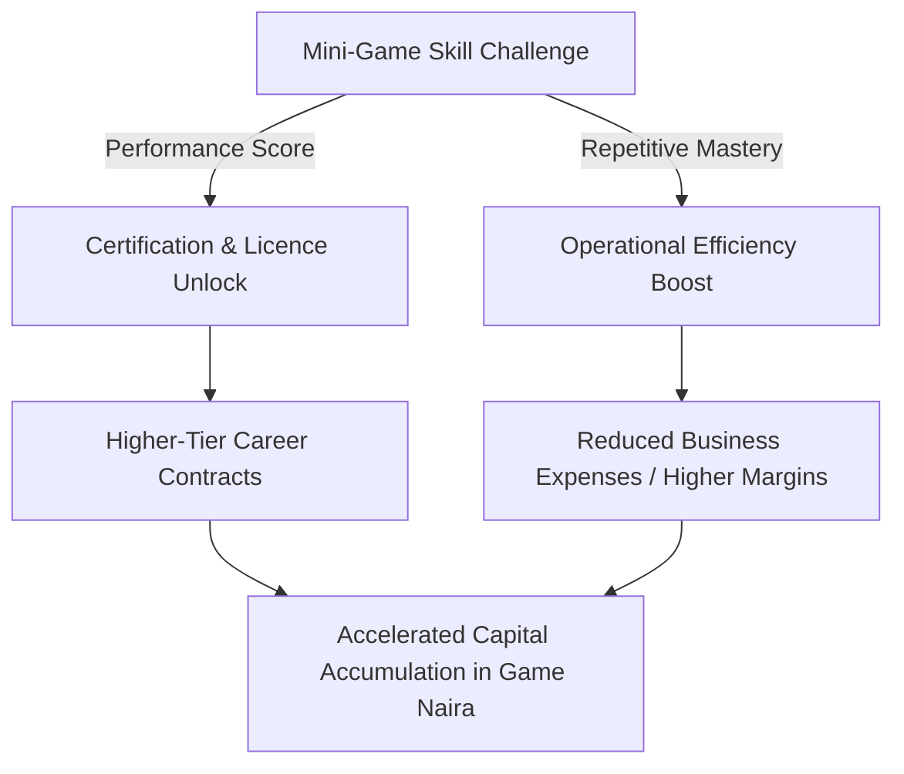

# DOCUMENT 05 — GAMEPLAY & MINI-GAME BIBLE
## Career Progression Mechanics, Skill Challenges & Economic Feed Loops

> **Core Invariant**: Mini-games in Project Eko are not arbitrary arcade distractions. Each mini-game is a mechanical qualification or productivity multiplier that directly feeds into the player's career, business profitability, and social reputation.

---

## 1. Systemic Architecture: How Skills Feed the World

Every mini-game produces a **Skill Grade (S, A, B, C, F)** and a **Telemetry Hash**. High grades unlock specific commercial privileges in the persistent world.

---

## 2. Core Career Mini-Games & Mechanics

### 2.1 The Official Driving Test (Mobility Gatekeeper)
* **Career Unlocked**: Passenger Taxi Driver, Executive Chauffeur, Delivery Dispatcher.
* **Location**: Alausa Secretariat Licensing Grounds / Onikan Testing Track.
* **Core Mechanic**:
  1. *Hill Start & Clutch Balancing*: Release handbrake, balance clutch and throttle on a 15-degree incline without rolling backward more than 0.2 meters.
  2. *Parallel Reverse Parking*: Steer between tight traffic cones within 45 seconds using side and rearview mirrors.
  3. *Lagos Junction Etiquette*: Navigate an unsignaled 4-way intersection yielding correctly to oncoming heavy vehicles and recognizing hand signals.
* **Scoring**: Time elapsed, cone clearance margin, smoothness of braking ($G$-force telemetry).
* **World Consequence**: Failing prevents the player from operating legal commercial ride-hailing; driving without a license incurs heavy fines if stopped by VIS (*Vehicle Inspection Service*) traffic police.

---

### 2.2 The Danfo Conductor Challenge (Transit Efficiency)
* **Career Unlocked**: Commercial Minibus Route Operator, Transit Fleet Manager.
* **Location**: Active Danfo routes (e.g., Ojota $\rightarrow$ Ketu $\rightarrow$ Mile 12).
* **Core Mechanic**:
  1. *Voice Callout Rhythm Game*: Hit directional rhythm prompts matching district names (*"Mile 12 entering! Ketu with your change!"*) as the bus cruises past bus stops. Accurate timing increases passenger boarding rates by up to 40%.
  2. *Fare & Change Math*: Fast mental arithmetic mini-game. Passengers hand over ₦1,000, ₦500, or ₦200 notes; the player must rapidly select the exact combination of ₦100, ₦50, and ₦20 notes within 3 seconds.
  3. *Door Latch Quick-Time*: Tap spacebar/button to securely close the creaky sliding door right before the driver accelerates.
* **World Consequence**: Eliminates passenger fare fraud, prevents passenger drops, and maximizes route revenue per kilometer.

---

### 2.3 Mechanic Bay: Engine Diagnostics & Component Repair
* **Career Unlocked**: Auto Mechanic, Garage Owner, Fleet Maintenance Engineer.
* **Location**: Mechanic yards in Mushin, Tejuosho, and Ikeja.
* **Core Mechanic**:
  1. *Audio & Visual Inspection*: Listen to engine audio cues (rattling timing chain, squealing alternator belt, knocking connecting rods) and inspect engine bay hot-spots using an infrared thermometer.
  2. *Bolt Sequence & Torque Wrenching*: Unscrew cylinder head or wheel lug-nuts in a criss-cross pattern; tighten to correct torque tolerances.
  3. *Wiring & Fuse Box Puzzle*: Connect color-coded wiring harnesses to resolve electrical shorts caused by flooded streets.
* **World Consequence**: Repairing your own vehicles slashes maintenance costs by **70%**; operating a public workshop allows players to service other players' damaged vehicles for Game Naira fees.

---

### 2.4 Market Bargaining & Wholesale Trading
* **Career Unlocked**: Wholesale Merchant, Retail Store Owner, Importer.
* **Location**: Balogun Market (Textiles), Alaba International (Electronics), Mile 12 (Produce).
* **Core Mechanic**:
  * Dynamic dialogue negotiation tree against seasoned AI market traders.
  * *Tension Meter*: If you bid too aggressively low, the trader gets offended (*"Comot for my shop!"*) and ends the negotiation. If you bid too high, you overpay.
  * *Cultural Rapport Tactics*: Using authentic Yoruba phrases (*"E kaaro ma"*, *"E saanu mi"*), purchasing in bulk bundles, or leveraging market reputation lowers wholesale unit prices by 15–35%.
* **World Consequence**: Directly determines the inventory cost basis for player-owned shops, directly expanding retail profit margins.

---

### 2.5 Dispatch Desk: Logistics Routing & Load Balancing
* **Career Unlocked**: Logistics Operator, Courier Fleet Director.
* **Location**: Commercial logistics depots in Oshodi and Apapa.
* **Core Mechanic**:
  * Real-time spatial bin-packing and routing puzzle.
  * Players are presented with 8 delivery parcels with differing dimensions, weights, fragilities, and destination deadlines across Lagos districts.
  * Pack the motorcycle top-box or delivery van to optimize center of gravity, then plot the optimal delivery route avoiding current traffic bottlenecks (*go-slow* hotspots).
* **World Consequence**: Yields massive bonuses for same-day delivery compliance; prevents damaged cargo claims.

---

### 2.6 Kitchen Sprint: Authentic Culinary Mastery
* **Career Unlocked**: Mama-Put Chef, Restaurant Owner, Luxury Caterer.
* **Location**: Street canteens in Yaba, event catering kitchens, upscale VI restaurants.
* **Core Mechanic**:
  * High-intensity time-management cooking simulator.
  * Stir and pound yam to the right consistency; balance spice and seasoning ratios in pepper soup; stir-fry authentic party jollof over simulated firewood heat without burning the pot.
  * Manage customer queues during the 13:00 lunchtime rush hour.
* **World Consequence**: High-quality meals produce extended player stamina buffs; catering contracts for Saturday Owambe weddings yield massive lump-sum payouts.

---

### 2.7 Street Football (5v5 Cage Match)
* **Career Unlocked**: Professional Athlete, Academy Scout, Tournament Champion.
* **Location**: National Stadium Surulere, Campos Mini Stadium Lagos Island, Lekki sand turf.
* **Core Mechanic**:
  * Fast-paced, physics-driven 5-a-side street soccer.
  * Quick short passes, low center-of-gravity dribbling, skill nutmegs (*"k-leg"*), and tight finishing on small goalposts.
  * Team stamina and chemistry dictate momentum.
* **World Consequence**: Neighborhood bragging rights, street prestige, sponsorship deals with athletic brands, and high-stakes tournament prize pools.

---

### 2.8 Music Studio: Afrobeats Production & DJ Mixing
* **Career Unlocked**: Sound Engineer, Music Producer, Club DJ.
* **Location**: Recording studios in Yaba, Lekki Phase 1, and Surulere.
* **Core Mechanic**:
  * Step-sequencer and rhythm arrangement game.
  * Layer authentic percussion (talking drums, shekere, log-drum basslines), chords, and saxophone riffs into contagious Afro-fusion rhythms.
  * DJ Mode: Beatmatch tracks, manage dancefloor energy levels, and drop siren sound-effects at peak club hours.
* **World Consequence**: Produced tracks can be broadcast on in-game car radio stations; top tracks earn royalties whenever other players play them in their vehicles!

---

### 2.9 Real Estate Property Inspection & Staging
* **Career Unlocked**: Real Estate Agent, Property Developer, Landlord.
* **Location**: Residential districts in Surulere, Ikeja GRA, Lekki, and Ikoyi.
* **Core Mechanic**:
  * 3D walkthrough inspection tool.
  * Spot hidden structural flaws: damp wall patches from roof leaks, faulty borehole water pumps, cracked foundations, and obsolete wiring.
  * Interior decoration staging: arrange furniture and modern appliances within budget to maximize rental valuation.
* **World Consequence**: Prevents purchasing lemon properties; raises rental yields on leased residential units by up to 25%.

---

### 2.10 Corporate Recruitment & Staff Management
* **Career Unlocked**: Managing Director, Enterprise Tycoon, Fleet Boss.
* **Location**: Corporate offices in Victoria Island and Marina.
* **Core Mechanic**:
  * Review candidate resumes, conduct personality interviews, match work traits to job roles (e.g., patient drivers for executive sedans; aggressive, energetic conductors for Oshodi Danfos).
  * Set salary scales, performance commission percentages, and monitor driver incident rates.
* **World Consequence**: High-tier staff operate autonomous company revenue generation, allowing tycoons to build multi-million Game Naira passive income streams.
