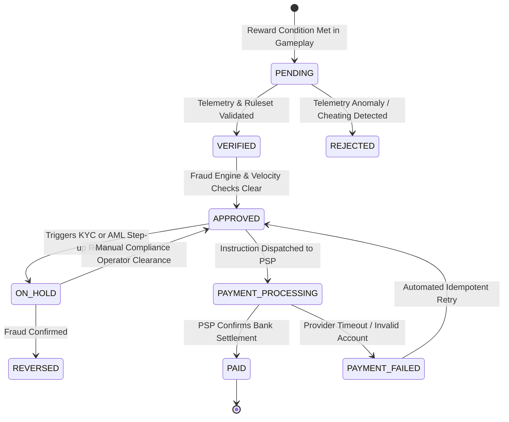

# DOCUMENT 07 — REAL-REWARD ECONOMY & COMPLIANCE SPEC
## Regulatory-Safe Real Earning Architecture, Anti-Fraud & Payout State Machine

> **The Compliance Invariant**: Project Eko is **NOT a gambling platform, lottery, or consumer deposit wallet**. Real monetary payouts flow exclusively through an **Accounts Payable (AP)** framework funded by external corporate sponsors, platform advertising, and legitimate creator revenue-shares. 
> 
> Game Naira is never convertible to real currency. Players never stake or risk capital against each other.

---

## 1. Regulatory Baseline & Legal Classification

```
┌──────────────────────────┬─────────────────────────────┬─────────────────────────────────────────────────┐
│ Regulatory Domain        │ Applicable Authority / Law  │ Architectural Design Response                   │
├──────────────────────────┼─────────────────────────────┼─────────────────────────────────────────────────┤
│ Gaming & Lotteries       │ Lagos State Lotteries and   │ No player staking; zero chance/luck mechanics;  │
│                          │ Gaming Authority (LSLGA) /  │ pure skill qualifications; non-wagering sponsor │
│                          │ NLRC (National)             │ challenge pools cleared as skill competitions.  │
├──────────────────────────┼─────────────────────────────┼─────────────────────────────────────────────────┤
│ Banking & Payment System │ Central Bank of Nigeria     │ Zero stored-value consumer wallet; no player-to-│
│                          │ (CBN) Guidelines            │ player fiat transfers; all cash-outs processed  │
│                          │                             │ as AP expense via licensed PSP payout rails.    │
├──────────────────────────┼─────────────────────────────┼─────────────────────────────────────────────────┤
│ Data Protection & Privacy│ Nigeria Data Protection     │ Privacy-by-design; strict KYC data minimization;│
│                          │ Commission (NDPA 2023)      │ AES-256 encrypted PII storage; explicit consent.│
├──────────────────────────┼─────────────────────────────┼─────────────────────────────────────────────────┤
│ Youth & Minor Protection │ Nigerian Child Rights Act   │ Age-gating (18+ required for cash-out); minors  │
│                          │                             │ enjoy 100% full gameplay in pure simulation mode│
└──────────────────────────┴─────────────────────────────┴─────────────────────────────────────────────────┘
```

---

## 2. Permitted Real-Earning Mechanisms

Real payouts are triggered **only** by verified economic contributions funded by external capital:

```
                                [ EXTERNAL SPONSOR / ADVERTISER ]
                                 (e.g., Telecom, Bank, FMCG Brand)
                                                │
                                                ▼ [Funds Contracted Budget]
┌─────────────────────────────────────────────────────────────────────────────────────────────┐
│ 1. SPONSOR-FUNDED SKILL CHALLENGES (e.g., Safe Driver Eco-Challenge)                        │
│ • Fixed reward pool provided by sponsor. Zero entry fee.                                    │
│ • Players who achieve safe-driving telemetry thresholds receive a fixed payout (e.g. ₦5,000)│
├─────────────────────────────────────────────────────────────────────────────────────────────┤
│ 2. CREATOR REVENUE SHARE                                                                    │
│ • In-game creators/musicians receive a contractual % of verified brand activations,        │
│   sponsored owambe tickets, or digital merchandise created for brands.                      │
├─────────────────────────────────────────────────────────────────────────────────────────────┤
│ 3. COMMERCIAL AFFILIATE & PERFORMANCE COMMISSIONS                                           │
│ • Players completing real-world partner actions (e.g., opening a sponsor bank account or     │
│   ordering via an integrated grocery partner) earn verified performance fees.               │
└─────────────────────────────────────────────────────────────────────────────────────────────┘
```

---

## 3. The Payout State Machine & Accounts Payable Lifecycle

Cash-outs are never instant, unverified wallet withdrawals. They follow an immutable 7-state accounting workflow:



### State Definitions
1. **`PENDING`**: Event recorded by the game server. Client claims are completely ignored; the server initiates validation.
2. **`VERIFIED`**: Automated physics and telemetry replay checks verify the run was legitimate and human-executed.
3. **`APPROVED`**: Player KYC status, age verification, and daily payout caps are checked. Reward payable record created.
4. **`ON_HOLD`**: Suspicious activity, abnormal IP velocity, or cumulative monthly volume exceeds ₦50,000 threshold. Queued for manual human compliance review.
5. **`PAYMENT_PROCESSING`**: Payout instruction dispatched to external licensed PSP API with a unique idempotent payment key.
6. **`PAID`**: Webhook confirmation received from PSP with immutable external bank transaction reference.
7. **`REVERSED` / `REJECTED`**: Marked as fraudulent, logged in audit register, and associated account flagged.

---

## 4. Cryptographic Proof & Anti-Fraud Telemetry Package

To claim a sponsor-funded skill reward, the game client does not send `"I completed the mission"`. The client streams continuous session input vectors, and the server computes an immutable **Reward Evidence Package**:

```json
{
  "evidence_id": "ev_8f93a102-bc34-4d89-9b7e-1289cf00129a",
  "mission_id": "mis_safe_driver_challenge_wk42",
  "ruleset_version": "v1.4.2_production",
  "player_id": "usr_99214012",
  "session_token_hash": "e3b0c44298fc1c149afbf4c8996fb92427ae41e4649b934ca495991b7852b855",
  "telemetry": {
    "start_timestamp": 1728345600120,
    "end_timestamp": 1728346380450,
    "total_distance_meters": 8420.5,
    "average_speed_kmh": 48.2,
    "max_speed_kmh": 78.4,
    "hard_braking_events": 1,
    "collision_impulse_sum": 0.0,
    "route_checkpoint_hashes": [
      "chk_01_ojota_pass",
      "chk_02_maryland_pass",
      "chk_03_fadeyi_pass",
      "chk_04_cms_terminal"
    ]
  },
  "risk_score": 0.04,
  "server_signature": "MEQCID7xY...30450220...3f8a=="
}
```

### 4.1 Anti-Fraud Heuristic Checks
1. **Impossible Speed & Teleportation Detection**: Position deltas between ticks exceeding physical vehicle top speed trigger instant disqualification.
2. **Deterministic Physics Replay**: On high-value rewards ($>₦10,000$), the server re-runs the recorded player input vectors through a headless physics simulation; discrepancy between rendered position and server state triggers an immediate review hold.
3. **Macro & Bot Input Smoothing**: Automated scripts produce unnaturally constant steering angles or binary throttle pulses. Human driving exhibits micro-jitter and varying reaction latency.
4. **Device Fingerprinting & Multi-Accounting**: Detection of multiple accounts farming rewards from identical browser hardware fingerprints or proxy networks.

---

## 5. KYC, AML Tiers & Payment Rails

Cash payouts integrate with licensed Nigerian Payment Service Providers (**Paystack, Flutterwave, Monnify**) adhering to tiered Know-Your-Customer regulations:

```
┌──────┬──────────────────────┬──────────────────────────────┬────────────────────────────────────────┐
│ Tier │ Lifetime Payout Cap  │ Verification Requirements    │ Payment Method Allowed                 │
├──────┼──────────────────────┼──────────────────────────────┼────────────────────────────────────────┤
│ T0   │ ₦0 (Simulation Only) │ Unverified / Minor Player    │ Ineligible for real cash-out           │
├──────┼──────────────────────┼──────────────────────────────┼────────────────────────────────────────┤
│ T1   │ ₦25,000 / month      │ Verified Phone + Verified    │ Direct NIP Bank Transfer (Account name │
│      │                      │ Nigerian Bank Account (18+)  │ must match registered user identity)   │
├──────┼──────────────────────┼──────────────────────────────┼────────────────────────────────────────┤
│ T2   │ ₦100,000 / month     │ Bank Verification Number     │ Commercial Bank Account                │
│      │                      │ (BVN) / NIN Match + Liveness │                                        │
├──────┼──────────────────────┼──────────────────────────────┼────────────────────────────────────────┤
│ T3   │ Unlimited (Partner)  │ Full Corporate KYC / Tax ID  │ Corporate Bank Account Wire            │
│      │                      │ for Registered Creators      │                                        │
└──────┴──────────────────────┴──────────────────────────────┴────────────────────────────────────────┘
```

* **Anti-Money Laundering (AML) Velocity Limits**: Maximum of 1 payout request per 24 hours per verified citizen; mandatory 48-hour cooling-off period following bank account change.
