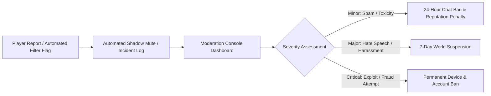

# DOCUMENT 08 — MULTIPLAYER & SOCIAL WORLD SPEC
## Spatial Networking, Social Fabric, Crews & Community Trust

> **The Social Doctrine**: Project Eko is a shared social organism. Players do not just coexist as isolated avatars; they form transport unions, co-found commercial logistics syndicates, challenge each other to street races across Third Mainland Bridge, attend lavish Saturday owambes, and negotiate business partnerships.

---

## 1. Network Topology & Zone Sharding Model

A seamless, browser-based multiplayer world cannot handle 10,000 players in a single continuous physics room. Project Eko uses **Interest Management & Geographic Zone Sharding**:

```mermaid
graph TD
    CLIENT[Web Client - Three.js] <-->|WebSocket / WebTransport| EDGE_ROUTER[Edge Proxy & Load Balancer]
    EDGE_ROUTER <--> ZONE_A[Zone Worker: Marina / CMS\n(32–64 CCU)]
    EDGE_ROUTER <--> ZONE_B[Zone Worker: Yaba / Ojuelegba\n(32–64 CCU)]
    EDGE_ROUTER <--> ZONE_C[Zone Worker: Lekki / VI\n(32–64 CCU)]
    
    ZONE_A & ZONE_B & ZONE_C <--> REDIS_PUBSUB[Redis Ephemeral Presence & Cross-Zone Bus]
    ZONE_A & ZONE_B & ZONE_C --> POSTGRES[Persistent World & Event Store]
```

### 1.1 Spatial Synchronization & Tick Rates
* **Simulation Tick Rate**: Server zone instances run at **20–30 Hz**.
* **Client Interpolation (Hermite Spline)**: The client buffers snapshots by 100ms, smoothly interpolating remote avatar positions and vehicle wheels to prevent visual jitter or rubber-banding.
* **Area of Interest (AoI) Culling**: Players only receive high-frequency state updates for entities within an **80-meter radius** (pedestrians) or **250-meter radius** (speeding vehicles).

---

## 2. Social Structures: Crews, Guilds & Transport Unions

Players self-organize into formal associations with deep economic and gameplay benefits:

```
┌──────────────────────────┬─────────────────────────────┬─────────────────────────────────────────────────┐
│ Organization Type        │ Structure & Requirement     │ Systemic Gameplay & Economic Benefit            │
├──────────────────────────┼─────────────────────────────┼─────────────────────────────────────────────────┤
│ Transport Union          │ Minimum 5 commercial drivers│ Controls bus park loading priority; negotiates  │
│ (e.g., Eko Drivers Club) │ + shared operating garage   │ bulk fuel discounts at partner filling stations │
├──────────────────────────┼─────────────────────────────┼─────────────────────────────────────────────────┤
│ Logistics Syndicate      │ Dispatch operators, fleet   │ Unlocks high-volume corporate cargo contracts   │
│ (e.g., Mainland Express) │ owners, warehouse managers  │ from Apapa port to Computer Village Ikeja       │
├──────────────────────────┼─────────────────────────────┼─────────────────────────────────────────────────┤
│ Street Racing Crew       │ Tuner vehicle owners        │ Hosts underground night drag races on Third     │
│ (e.g., Bridge Runners)   │                             │ Mainland Bridge; custom vinyl car livery decals │
├──────────────────────────┼─────────────────────────────┼─────────────────────────────────────────────────┤
│ Creative Collective      │ Fashion designers, DJs,     │ Co-hosts sponsored Saturday Owambes & club nights;│
│ (e.g., Lasgidi Wave)     │ event organizers            │ splits ticket and merchandise revenue           │
└──────────────────────────┴─────────────────────────────┴─────────────────────────────────────────────────┘
```

### 2.1 Shared Crew Banks & Asset Pools
* Crews can pool Game Naira into a **Shared Crew Treasury** with role-based withdrawal permissions (Chairman, Treasurer, Member).
* High-tier crews can co-own shared commercial assets: e.g., a 10-bay mechanic depot in Oshodi or a luxury party penthouse in Victoria Island.

---

## 3. Communication, Proximity Chat & Social HUD

```
[ IN-WORLD SOCIAL INTERFACE ]
┌─────────────────────────────────────────────────────────────────────────────┐
│ [PROXIMITY RADIAL MENU (Hold 'E' on Player)]                                │
│        [Profile / Reputation]                                               │
│   [Offer Passenger Ride]    [Invite to Crew]                                │
│   [Trade / Transfer GN]     [Report Conduct]                                │
│                                                                             │
│ [CHAT CHANNELS (In-game Phone & HUD)]                                       │
│ • [Local Area (Spatial Text)]: "Who get extra tyre for Third Mainland?"     │
│ • [Crew Channel]: "Danfo #04 just reached Mile 12. Bring the relief bus."   │
│ • [Direct Message]: Private encrypted chat between friends.                 │
│ • [City Radio Dispatch]: Public announcements for citywide events & weather.│
└─────────────────────────────────────────────────────────────────────────────┘
```

* **Spatial Proximity Text Chat**: Messages fade in volume/opacity beyond 25 meters, creating natural localized conversations in markets and clubs.
* **Voice Chat Roadmap**: Voice chat is explicitly **deferred to post-beta** until automated moderation and network performance across low-bandwidth African cellular connections can be guaranteed.

---

## 4. Player-to-Player Interactions & Economy

1. **Ride-Sharing (Driver & Passenger Co-Op)**:
   * A driver can open their passenger doors; other players can hop into the front passenger seat or rear Danfo rows.
   * Passengers can set GPS waypoints on the driver's HUD and automatically split fares via EkoBank.
2. **Co-Op Minibus Operations**:
   * One player drives the Danfo bus while another player acts as the conductor hanging out of the door, calling fares and managing change!
   * Both players receive a 15% cooperative income bonus.
3. **Player Bartering & Marketplace Trading**:
   * Secure face-to-face trade window for swapping vehicle parts, custom fashion items, or business inventory with escrow verification.

---

## 5. Trust, Safety & Content Moderation

To protect community health and prevent harassment, exploitation, and abuse:



* **Automated Text Filtering**: Real-time contextual filtering covering English, Nigerian Pidgin, and Yoruba profanities, slurs, and predatory behavior.
* **Safe Zone Sanctuaries**: Selected civic and religious spaces (e.g., City Hall, National Museum grounds) are designated non-collision, passive-only zones where aggressive vehicle ramming is disabled.
* **Reputation Shielding**: Players with low reputation scores (frequent reckless driving, unpaid fines, excessive reports) are automatically matched into separate low-priority zone instances.
