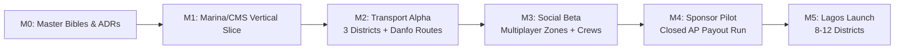

# DOCUMENT 10 — ANTIGRAVITY MASTER BUILD SYSTEM
## Engineering Monorepo Architecture, Autonomous Agent Guild & Execution Protocol

> **The Operational Invariant**: No agent writes simulation or financial code without an approved ADR, an explicit threat model, and automated regression tests. Code quality, security boundaries, and cultural authenticity are non-negotiable.

---

## 1. Monorepo Structural Blueprint

The codebase is organized as a clean, high-performance monorepo supporting web, backend, realtime workers, and shared game mathematics:

```
project-eko/
├── ANTIGRAVITY/                       # The 10 Definitive Master Bibles & Agent Directives
│   ├── 00_MASTER_CONTEXT/             # Strategic vision & product promise
│   ├── 01_PRD/                        # Master Product Requirements Document
│   ├── 02_WORLD_BIBLE/                # Lagos district catalogue & transport spine
│   ├── 03_VEHICLE_PHYSICS/            # Automotive physics, handling & fleet wear
│   ├── 04_CULTURE/                    # Authentic Nigerian cultural systems & soundscapes
│   ├── 05_GAMEPLAY_MINIGAMES/         # Career-feeding skill challenges
│   ├── 06_ECONOMY/                    # Double-entry ledger constitution
│   ├── 07_REAL_REWARDS/               # Accounts payable compliance & anti-fraud
│   ├── 08_MULTIPLAYER/                # Zone sharding & social networking
│   ├── 09_IP_AND_ASSETS/              # Licensing matrix & glTF 3D pipeline
│   ├── 10_ARCHITECTURE/               # Monorepo architecture & build system
│   ├── AGENTS/                        # System prompts & boundaries for AI subagents
│   └── DELIVERY/                      # Milestones, ADRs, and verification test plans
│
├── apps/
│   ├── web/                           # Next.js / Vite web shell & account onboarding
│   ├── game/                          # Three.js / WebGPU 3D client & EkoPhone interface
│   ├── admin/                         # Trust, safety & ledger reconciliation console
│   └── creator/                       # Brand sponsor campaign & creator portal
│
├── services/
│   ├── api/                           # Modular domain API (Auth, Profiles, Careers, Businesses)
│   ├── realtime/                      # Zone session workers (20–30Hz tick, Redis, player sync)
│   ├── rewards/                       # Reward evidence hashing, fraud heuristics, campaign pools
│   └── payouts/                       # PSP adapters (Paystack/Flutterwave) & AP state machine
│
├── packages/
│   ├── game-core/                     # Shared simulation primitives & deterministic math
│   ├── physics/                       # Vehicle dynamics & handling profiles
│   ├── economy/                       # Double-entry ledger, debit/credit invariants, sinks/sources
│   ├── contracts/                     # OpenAPI schemas, WebSocket events, telemetry contracts
│   ├── world/                         # District layouts, road graphs, LAMATA route tables
│   ├── ui/                            # Design system for City HUD and in-game EkoPhone
│   └── telemetry/                     # Cryptographic event signature schemas
│
└── infra/
    ├── db/                            # PostgreSQL migrations & database seeds
    ├── deploy/                        # Dockerfiles, Kubernetes zone manifests, CI/CD
    └── tests/                         # End-to-end replay fixtures & load testing harnesses
```

---

## 2. The Specialized Agent Guild

Each subagent operates within an explicit domain boundary with an enforced role definition:

```
┌─────────────────┬────────────────────────────────────────────┬──────────────────────────────────────┐
│ Agent Role      │ Domain Responsibility                      │ Required Output Artifacts            │
├─────────────────┼────────────────────────────────────────────┼──────────────────────────────────────┤
│ ARCHITECT       │ Monorepo structure, API contracts, ADRs,   │ ADR documents, OpenAPI schemas,      │
│                 │ module isolation, boundary enforcement.    │ system sequence diagrams.            │
├─────────────────┼────────────────────────────────────────────┼──────────────────────────────────────┤
│ WORLD_BUILDER   │ OSM topology ingest, navmesh generation,   │ District manifests, road graphs,     │
│                 │ district coordinates, landmark placement.  │ landmark placement configs.          │
├─────────────────┼────────────────────────────────────────────┼──────────────────────────────────────┤
│ VEHICLE_SIM     │ Pacejka tyre physics, suspension math,     │ Vehicle handling configs, physics    │
│                 │ weight transfer, damage deformation.       │ benchmark logs, replay tests.        │
├─────────────────┼────────────────────────────────────────────┼──────────────────────────────────────┤
│ GAMEPLAY        │ Career progression, certification tests,   │ Mini-game logic, scoring algorithms, │
│                 │ bus routes, mini-game challenge loops.     │ quest state machines.                │
├─────────────────┼────────────────────────────────────────────┼──────────────────────────────────────┤
│ REALTIME        │ Zone session workers, state snapshots,     │ WebSocket servers, Hermite spline    │
│                 │ AoI culling, Redis presence pub/sub.       │ interpolation, load test reports.    │
├─────────────────┼────────────────────────────────────────────┼──────────────────────────────────────┤
│ ECONOMY         │ Double-entry ledger, transaction safety,   │ PostgreSQL migrations, ledger test   │
│                 │ sinks/sources balancing, inflation rules.  │ packs, zero-mismatch invariants.     │
├─────────────────┼────────────────────────────────────────────┼──────────────────────────────────────┤
│ REWARDS_RISK    │ Telemetry evidence hashing, impossible-    │ Threat model analysis, fraud ruleset,│
│                 │ speed detection, replay verification.      │ cryptographic signing routines.      │
├─────────────────┼────────────────────────────────────────────┼──────────────────────────────────────┤
│ PAYMENTS        │ Accounts payable state machine, licensed   │ PSP adapter integration tests,       │
│                 │ PSP integrations, reconciliation queues.   │ idempotent payout scripts.           │
├─────────────────┼────────────────────────────────────────────┼──────────────────────────────────────┤
│ ART_ASSET       │ 3D asset pipeline, glTF Draco optimization,│ Asset manifests, LOD configurations, │
│                 │ IP rights classification register.         │ legal clearance audit log.           │
├─────────────────┼────────────────────────────────────────────┼──────────────────────────────────────┤
│ QA_BROWSER      │ Automated headless browser runs, UI smoke  │ Browser recordings, visual diffs,    │
│                 │ tests, performance/latency validation.     │ end-to-end user journey traces.      │
└─────────────────┴────────────────────────────────────────────┴──────────────────────────────────────┘
```

---

## 3. Architecture Decision Records (ADRs) Sequence

Before modifying code in `apps/`, `services/`, or `packages/`, the ARCHITECT agent records decisions following this index:

* **ADR-0001**: *Modular Monolith Core with Dedicated Realtime Zone Workers*.
* **ADR-0002**: *Hard Two-Economy Boundary: Simulation Game Naira vs. Accounts Payable Real Rewards*.
* **ADR-0003**: *Server-Authoritative Cryptographic Telemetry for Skill Reward Verification*.
* **ADR-0004**: *Pacejka Tyre Formulation & Deterministic Raycast Suspension Model*.
* **ADR-0005**: *PostgreSQL Double-Entry Accounting Ledger with Idempotency Guarantees*.
* **ADR-0006**: *OpenStreetMap Topological Data Pipeline & ODbL Attribution Architecture*.
* **ADR-0007**: *glTF/Draco Binary Asset Pipeline with Mobile GPU Texture Optimization*.

---

## 4. Delivery Milestone Verification Protocol

Progress is gated by concrete, non-negotiable exit criteria:



### Exit Gate Requirements for M1 (Vertical Slice):
1. **Zero Console Errors**: Browser client runs in Chrome and Safari with $\ge 60$ FPS on desktop, $\ge 30$ FPS on mid-tier mobile.
2. **Physics Roadworthiness**: Entry car and Danfo exhibit noticeable weight transfer, braking distance variation under rain, and responsive steering.
3. **Double-Entry Balance**: 1,000 automated test job transactions run with **0 balance discrepancies** in the PostgreSQL ledger.
4. **Idempotency Validated**: Duplicate mission payout calls return HTTP 200 with identical transaction references and zero extra coin minting.
