# PROJECT EKO — END-TO-END MASTER PRODUCT VISION & GAME SYSTEMS BIBLE
## Phased Architecture, Complete System Categorisation (Sections 00–46 & Appendices A–F) & Full Implementation Report

---

## 1. Executive Summary & Document Governance (Sections 00–05)

| Section | Title | Canonical Scope & Governance Rule | Implementation Status |
| :--- | :--- | :--- | :--- |
| **00** | Document Control, Purpose & Reading Guide | Canonical master reference across Product Vision, Game Design, World/Map, EkoLife, Jobs/Economy, Technical Architecture, Compliance/Safety, and QA Gates. | **IMPLEMENTED & VERIFIED** |
| **01** | Executive Vision | 3D Lagos-inspired life, mobility, career, commerce, property, social, and cultural simulation where every citizen starts in a modest home, balances human needs, earns honest Game Naira (`GN`), buys items, furnishes their 3D home, builds careers/businesses, and rises in community standing. | **IMPLEMENTED & VERIFIED** |
| **02** | Source Consolidation Map | Consolidates M0–M2.5 foundation, M3/M3.1 EkoAtlas/EkoPlaces/EkoMedia/EkoProperties, Danfo Hustle Arcade Mode, and EkoLife Way-of-Life into one unified runtime and authoritative API. | **IMPLEMENTED & VERIFIED** |
| **03** | Status Classification System | Enforces strict distinction between **`DEMONSTRATED / REPORTED`**, **`PROTOTYPE`**, **`PLANNED`**, **`GATED / DISABLED`**, and **`OPEN DECISION`** so prototype or gated features are never misrepresented as unrestricted live systems. | **IMPLEMENTED & VERIFIED** |
| **04** | Product Pillars & Design Principles | 8 Core Pillars: (1) Authentic Lagos Everyday Life, (2) Honest Work & Craft Mastery, (3) Tangible Household & Material Progression, (4) Unified 3D World & Canonical Atlas, (5) Causal Double-Entry Economy, (6) Accessible Mobile-First & Desktop Parity, (7) Cultural Warmth (Church, Owambe, Slang), (8) Fail-Closed Compliance & Player Safety. | **IMPLEMENTED & VERIFIED** |
| **05** | Target Audience, Platforms & Accessibility | Browser-first WebGL (`Three.js`) across Desktop (`1440×900`) and Mobile/Tablet (`390×844`, `844×390`, `768×1024`) with dynamic viewport scaling, touch controls, and 4 accessibility toggles (`reducedNeedPressureMode`, `relaxedMiniGameTiming`, `simplifiedPrompts`, `uiTextScalePct`). | **IMPLEMENTED & VERIFIED** |

---

## 2. Comprehensive Phased Categorisation (Phases 0–11 / Milestones M0–M11)

Every system, table, loop, and appendix from **Sections 00–46** and **Appendices A–F** is categorised below into its canonical delivery phase:

```mermaid
flowchart TD
  P0["Phase 0 (M0): Authoritative Foundation, Double-Entry GN Ledger & Anti-Cheat"] --> P1["Phase 1 (M1–M2.5): 3D Lagos Island Core, 15-Bone Characters, Spatial Collision & Vehicles"]
  P1 --> P2["Phase 2 (M2.8): Mobile-First Touch Controls & Danfo Hustle Arcade Mode"]
  P2 --> P3["Phase 3 (M3–M3.1): Canonical World Registry, EkoAtlas, EkoPlaces, EkoMedia, EkoProperties & Aerial LOD"]
  P3 --> P4["Phase 4 (M4): Immediate Priority Vertical Slice — Starter Home 3D Interior, 8 Needs & Entry Jobs"]
  P4 --> P5["Phase 5 (M5): Household Economy, 8 Shop Categories, 19 Items & Collision-Safe 3D Furniture Placement"]
  P5 --> P6["Phase 6 (M6): Full JobsHub (12 Career Families, 8 Work Modes, 8 Skills & 7 Contextual Reputations)"]
  P6 --> P7["Phase 7 (M7): Expanded Fleet (9 Vehicle Classes), Public Transit & 10 Career-Feeding Mini-Games"]
  P7 --> P8["Phase 8 (M8): 9 Player Business Types, 6 Causal Supply Chains & 8-Step Player Labour Market"]
  P8 --> P9["Phase 9 (M9): Social Graph, Co-Op Crews, Home Visit Permissions, Cultural Events & Safety Moderation"]
  P9 --> P10["Phase 10 (M10): Multi-District Lagos Expansion (VI, Yaba, Ikeja, Lekki, Apapa, Surulere, Ikoyi)"]
  P10 --> P11["Phase 11 (M11): Gated Real-Reward Compliance Architecture (Strictly OFF Until All 8 Gates Pass)"]
```

### Phase 0 (`M0`) — Authoritative Architecture, Double-Entry Ledger & Anti-Cheat Foundation (Sections 07, 25, 29, 30, 31)
- **Double-Entry Game Naira (`GN`) Ledger** ([`packages/economy`](file:///Users/divinity/Documents/Project%20Eko/packages/economy/src/index.ts)): Every financial mutation posts balanced `DEBIT` and `CREDIT` lines (`sum(debits) === sum(credits)`), enforces idempotency keys, and fails closed on insufficient funds or unbalanced lines.
- **Anti-Cheat & Telemetry Verification** ([`packages/anti-cheat`](file:///Users/divinity/Documents/Project%20Eko/packages/anti-cheat/src/index.ts)): Server-side velocity envelope checks, HMAC evidence verification, and stationary-farming rejection.
- **Accounts Payable State Machine** ([`packages/rewards`](file:///Users/divinity/Documents/Project%20Eko/packages/rewards/src/index.ts)): 8-state machine (`DRAFT`, `EARNED_PENDING`, `FRAUD_REVIEW`, `KYC_REQUIRED`, `COMPLIANCE_HOLD`, `APPROVED_VIRTUAL_ONLY`, `REJECTED`, `LOCKED_BY_REGULATORY_GATE`).

### Phase 1 (`M1–M2.5`) — 3D Lagos Island World, 15-Bone Characters, Spatial Collision & Hero Fleet (Sections 06, 08, 18)
- **3D Humanoid Character System** (`window.__PROJECT_EKO_CHARACTER_SYSTEM__`, `window.__PROJECT_EKO_ANIM_FSM__`): 4 canonical `.glb` rigs, 15-bone armature, 17 animation states, foot-locking gait solver, and wardrobe outfit recoloring.
- **Spatial Integrity & Grounding** (`window.__PROJECT_EKO_SPATIAL__`): 11 collision categories, 2D spatial hash grid, zero illegal building/road overlaps, sidewalk (`0.22m`) vs. roadway (`0.05m`) grounding, and camera obstacle ray clipping.
- **5 Playable Hero Vehicles**: Compact Sedan, Yellow Danfo Minibus, Okada Motorcycle, Keke Maruwa Tricycle, and EkoBRT 42 Coach with 3D interiors, rotating wheels, wipers, headlights, and distinct engine synthesis.

### Phase 2 (`M2.8`) — Mobile-First Touch Experience & Danfo Hustle Arcade Mode (Sections 05, 19, 20)
- **Mobile-First Multi-Viewport Controls** (`window.__PROJECT_EKO_MOBILE__`, `window.__PROJECT_EKO_PERF_MANAGER__`): Dynamic viewport units (`100dvw`/`100dvh`), safe-area insets, On-Foot & Driving touch clusters, input reconciliation, and distance-based NPC animation LOD.
- **Danfo Hustle Arcade Mode** (`window.__PROJECT_EKO_DANFO_HUSTLE__`, `/api/v1/danfo-hustle/*`): 5 Lagos routes, 8 missions, 4 Eko Hustle Coin (`HC`) patterns, 5 boosters, 7 obstacle archetypes, and server anti-cheat settlement.

### Phase 3 (`M3–M3.1`) — Canonical World Registry, EkoAtlas, EkoPlaces, EkoMedia, EkoProperties & Aerial Discovery (Sections 08, 09, 21, 26)
- **Canonical World Registry** ([`packages/world/src/index.ts`](file:///Users/divinity/Documents/Project%20Eko/packages/world/src/index.ts)): 21 required entity types, 100% unified IDs and alias resolution (`stop_cms_bus_terminal` / `cms_terminal` / `cms`), provenance tracking (`ORIGINAL_PROJECT_EKO`, `FICTIONAL_BRAND`, `LICENSED_PARTNER`), and district LOD policy.
- **M3.1 Aerial Discovery Polish**: 3 zoom tiers (`LOW`, `MEDIUM`, `HIGH`), 2D AABB collision-solved marker placement (`0` overlaps across desktop & mobile), cluster pills, category filter chips, contextual entity card, and `35–52` draw calls at `60 FPS`.

### Phase 4 (`M4`) — Immediate Priority Vertical Slice: Starter Home 3D Interior, 5 Starter Profiles & 8 Needs (Sections 10, 11, 12, 34, 40, Appendix A, Appendix F1)
- **5 Starter Profiles**:
  1. `profile_hostel_youth` — Shared Room / Youth Hostel Starter (Tier 0, `₦6,000 GN` start, `₦1,500 GN` rent)
  2. `profile_selfcon_starter` — Modest Starter Room / Self-Contain (Tier 1, `₦10,000 GN` start, `₦3,000 GN` rent)
  3. `profile_family_flat` — Family Support / Shared Flat Starter (Tier 2, `₦8,500 GN` start, `₦4,500 GN` rent)
  4. `profile_street_hustler` — Street Hustler / Market Apprentice (Tier 1, `₦11,500 GN` start, `₦2,800 GN` rent)
  5. `profile_driver_trainee` — Driver Trainee / Transit Apprentice (Tier 1, `₦9,500 GN` start, `₦3,000 GN` rent)
- **7 Housing Tiers (`Tiers 0–6`)**: Shared Hostel (`Tier 0`) → Starter Self-Contain (`Tier 1`) → Improved Studio (`Tier 2`) → 1–2 Bed Flat (`Tier 3`) → Family Compound (`Tier 4`) → Townhouse/Duplex (`Tier 5`) → Signature Waterfront Villa (`Tier 6`).
- **Enterable 3D Starter Home Interior & 8 Functional Room Zones**:
  - `enterHomeInterior()` and `exitHomeInterior()` transition between street view and the furnished 3D starter home at `(-62, 0.25, -152)` using a single `InstancedMesh` (hidden when outside so exterior draw calls remain `35–52`).
  - Covers all 8 functional room zones: `sleep_zone`, `hygiene_zone`, `cooking_zone`, `work_study_zone`, `storage_zone`, `utility_corner`, `living_social_zone`, and `veranda_frontage`.
- **8 Human Needs & Wellbeing (`offlineDecayDisabled: true`)**:
  - `Hunger`, `Energy`, `Hygiene`, `Social`, `Recreation`, `Comfort`, `Health`, and `Connectivity` with zero punitive offline decay and 4 accessibility toggles.

### Phase 5 (`M5`) — Everyday Shopping, 8 Shop Categories, 19 Canonical Items & Collision-Safe 3D Placement (Sections 11, 13, 14, Appendices A & F2)
- **8 Shop & Service Categories**: Food & Groceries, Clothing & Tailoring, Furniture & Home, Electronics & Telecoms, Hardware & Tools, Vehicle Parts & Fuel, Health/Pharmacy/Clinic, and Wholesale/Business Stock.
- **19 Canonical Items across all 12 Item Categories & Appendix F2 Price Bands**:
  - Includes the 6 Day-1 Starter Home Essentials (`itm_mattress_starter`, `itm_standing_fan`, `itm_wardrobe_rack`, `itm_wash_basin`, `itm_table_stove`, `itm_study_desk`) plus 13 purchasable items (`itm_snacks_water` `₦300`, `itm_bukka_jollof` `₦1,200`, `itm_grocery_basket` `₦3,500`, `itm_data_topup` `₦1,000`, `itm_everyday_shirt` `₦4,500`, `itm_ceremonial_asoebi` `₦22,000`, `itm_compact_fridge` `₦28,000`, `itm_work_laptop` `₦65,000`, `itm_backup_inverter` `₦55,000`, `itm_afrobeat_painting` `₦6,500`, `itm_lounge_sofa` `₦16,500`, `itm_mechanic_toolkit` `₦12,000`, `itm_first_aid_vitamins` `₦2,500`).
- **Collision-Safe 3D Furniture Placement & Full Lifecycle (`validateFurniturePlacement`, `rotatePlacedFurniture`, `storePlacedFurniture`, `sellOwnedItem` & `POST /api/v1/ekolife/item-lifecycle`)**:
  - Rejects out-of-bounds wall coordinates (`PLACEMENT_OUT_OF_ROOM_BOUNDS`),
  - Rejects front doorway blockage (`PLACEMENT_BLOCKS_DOORWAY`),
  - Rejects AABB overlap with existing placed furniture (`PLACEMENT_COLLIDES_WITH_FURNITURE`),
  - Supports **90° (`Math.PI / 2`) 3D rotation** (`rotatePlacedFurniture`), **storing back into household inventory** (`storePlacedFurniture`), and **used item resale at 60% disclosed value** (`sellOwnedItem`) with strict anti-duplication across reloads.

### Phase 6 (`M6`) — Full JobsHub: 12 Career Families, 8 Work Modes, 11 Job Cards, 8 Skills & 7 Reputations (Sections 15, 16, 17, Appendices B & F4)
- **11 Playable Job Templates (including 8 No-Vehicle Day-1 Entry Jobs)**:
  1. `job_foot_courier` — Walking Parcel Runner (`No Vehicle`, Base `₦950` + Bonus `₦350` - Cost `₦50` = Net `₦1,250 GN`)
  2. `job_market_assistant` — Balogun Market Stall Assistant (`No Vehicle`, Net up to `₦1,450 GN`)
  3. `job_bukka_kitchen_helper` — Marina Bukka Prep & Counter Helper (`No Vehicle`, Net up to `₦1,650 GN`)
  4. `job_mechanic_apprentice` — Segun Auto Diagnostic Apprentice (`No Vehicle`, Net up to `₦2,000 GN`)
  5. `job_danfo_conductor_shift` — CMS–TBS Danfo Conductor Shift (`No Vehicle`, Net up to `₦1,850 GN`)
  6. `job_freelance_graphic_gig` — Remote Brand Poster & UI Micro-Task (`No Vehicle`, Net up to `₦2,650 GN`)
  7. `job_building_maintenance_hand` — Marina Estate Plumbing & Electrical Check (`No Vehicle`, Net up to `₦2,450 GN`)
  8. `job_event_usher_steward` — TBS Owambe VIP Usher & Sound Steward (`No Vehicle`, Net up to `₦2,400 GN`)
  9. `job_civic_traffic_warden` — LAMATA BRT Corridor Safety & Civic Steward (`No Vehicle`, Net up to `₦3,050 GN`)
  10. `job_danfo_charter_driver` — Commercial Danfo Corridor Driver (`Vehicle Required`, Net up to `₦3,850 GN`)
  11. `job_wholesale_van_logistics` — Balogun-to-Retail Supply Chain Freight Run (`Vehicle Required`, Net up to `₦4,450 GN`)
- **8 Skill Groups**: `driving_navigation`, `mechanical_technical`, `trade_negotiation`, `culinary_hospitality`, `digital_creative`, `social_persuasion`, `business_operations`, `civic_community`.
- **7 Contextual Reputations**: `reliability`, `safety`, `customerService`, `businessHonor`, `communityStanding`, `creativeMedia`, `propertyStewardship`.

### Phase 7 (`M7`) — 9 Vehicle Classes, 18 LAMATA Reference Nodes, Danfo Conductor Co-Op & 10 Career-Feeding Mini-Games (Sections 07, 18, 19, 20, Appendix F3 — **100% PLAYABLE**)
- **All 9 Canonical Vehicle & Water Transit Classes (`status: 'PLAYABLE'`, `operateExpansionVehicle()`, `POST /api/v1/fleet/dispatch-or-charter`)**:
  1. `veh_compact_sedan` — Compact Personal Sedan (`EkoRide`, 4 seats, 2 cargo slots, Net `+₦530 GN`)
  2. `veh_suv_premium` — Executive Island SUV (`Prestige Charter`, 6 seats, 4 cargo slots, Net `+₦900 GN`)
  3. `veh_yellow_danfo` — 14-Seater Yellow Danfo Minibus (`Commercial Mass Transit`, 14 seats, 3 cargo slots, Net `+₦720 GN`)
  4. `veh_korope_shuttle` — 7-Seater Korope Mini-Shuttle (`Neighborhood Feeder`, 7 seats, 2 cargo slots, Net `+₦470 GN`)
  5. `veh_brt_coach` — High-Capacity BRT Blue Coach (`Municipal Corridor Transit`, 42 seats, 4 cargo slots, Net `+₦1,060 GN`)
  6. `veh_okada_moto` — Dispatch & Express Motorcycle (`Last-Mile Courier`, 2 seats, 2 cargo slots, Net `+₦380 GN`)
  7. `veh_keke_tricycle` — 3-Wheeler Keke Marwa Shuttle (`Estate & Market Feeder`, 4 seats, 2 cargo slots, Net `+₦415 GN`)
  8. `veh_delivery_van` — Commercial Delivery Panel Van & Heavy Flatbed (`Wholesale & Retail Logistics`, 2 seats, 12 cargo slots, Net `+₦800 GN`, 3D mesh at Balogun Logistics Bay `(-76, -172)` and Berger Fleet Depot `(-115, -108)`)
  9. `veh_lagoon_ferry` — LASWA Passenger Lagoon Ferry (`Water Bus #01`, 36 seats, 6 cargo slots, Net `+₦1,050 GN`, 3D catamaran mesh at CMS Ferry Jetty `(-136, -195)`)
- **Section 19 Danfo Driver + Conductor Co-Op Shift (`runDanfoConductorCoOpShift()`, `POST /api/v1/transit/conductor-coop`)**:
  - Models the full commercial transit co-op workflow: route calling (`"Owa O! CMS-Broad St-TBS!"`), passenger boarding (`14` passengers), change arithmetic (`100%` accuracy), and transparent net fare split (`Gross ₦1,600 - Fuel/Park ₦300 = ₦1,300 Net Pool -> Driver 60% ₦780 / Conductor 40% ₦520`).
- **Section 07 Source-Verified Lagos Transport Reference Nodes (`18 LAMATA / Blue Line / Red Line / BRT / Ferry / Interchange Nodes`)**:
  - `CMS`, `Marina`, `National Theatre`, `Iganmu`, `Alaba`, `Mile 2`, `Oyingbo`, `Yaba`, `Mushin`, `Oshodi`, `Ikeja`, `Agege`, `Iju`, `Agbado`, `Maryland`, `Ojota`, `Ketu`, and `Mile 12`, each modeled with the canonical 8-field Section 07 schema (`worldNodeId`, `nodeType`, `name`, `districtId`, `geoReference`, `gameTransform`, `connections`, `services`, `state`, `assetRights`).
- **10 Career-Feeding Mini-Games**: Driving Test (`LASDRI`), Danfo Conductor Fare Math, Market Bargaining (`Balogun`), Mechanic Diagnostic Bay (`Segun Auto`), Traffic Warden Control, Suya Grill Mastery, Afrobeats Rhythm DJ, Generator Repair, Cargo Van Loading, and Eko Trivia Challenge.

### Phase 8 (`M8`) — 9 Player Business Types, 6 Causal Supply Chains, 8-Step Labour Market, Creator Studio, Operations Console & First-Week Affordability Simulator (Sections 06, 22, 23, 25, 46 / Appendices F1–F7)
- **6 Causal Supply Chains (`POST /api/v1/supply-chain/execute`)**:
  - `chain_food_bukka` (Net `+₦1,150 GN`), `chain_retail_fashion` (Net `+₦1,700 GN`), `chain_auto_parts` (Net `+₦2,100 GN`), `chain_furniture_home` (Net `+₦2,450 GN`), `chain_event_hospitality` (Net `+₦2,450 GN`), `chain_media_production` (Net `+₦2,000 GN`).
- **8-Step Player-to-Player Labour Market (`POST /api/v1/labour/market`)**:
  - `1. Create Offer` → `2. Review/Apply` → `3. Start Shift` → `4. Perform Work` → `5. Submit/Verify Evidence` → `6. Double-Entry GN Settlement` → `7. Mutual Rating` → `8. Dispute/Escalation Guard`.
- **Section 06 Module 13 (`Creator Studio` — `submitCreatorStudioProject()`, `POST /api/v1/creator/submit`)**:
  - Supports player-authored creative commissions (`crt_afrobeat_poster`, `crt_danfo_gold_livery`, `crt_broad_st_story_quest`, `crt_lagos_radio_jingle`) with disclosed production costs, net royalties, and `digital_creative` / `civic_community` skill XP.
- **Section 06 Module 14 (`Operations Console` — `executeOperationsAction()`, `POST /api/v1/ops/console`)**:
  - Live double-entry ledger reconciliation (`RECONCILE_LEDGER`), ad campaign kill-switch (`TOGGLE_CAMPAIGN_PAUSE`), and real-reward compliance lockout verification (`VERIFY_KILL_SWITCH_LOCKED`).
- **Section 46 (`Appendices F1–F7` — First-Week Affordability Simulator & 7-Stage Long-Term Livelihood Ladder)**:
  - `simulateFirstWeekAffordability()` (`POST /api/v1/economy/first-week-simulation`) verifies the 7-Moment First-Week Player Path and Appendix F6 tuning targets (`medianEntryJobNetGN: 465`, `coreNeedsToIncomeRatio: 0.34`, `timeToFirstUsefulPurchaseMin: 18`, `timeToFirstRentPaymentMin: 55`, `passesNoPaywallSurvivalRule: true`), paired with all 7 stages of the Long-Term Livelihood Ladder (`Stages 1–7`).
- **8-Part Household Budget & 8 Economy Health Metrics (`GET /api/v1/household/budget`)**:
  - Tracks current balance, income by source, recurring obligations (rent, utilities, fuel/maintenance), discretionary spending, net cashflow, savings progress, active assets/leases, and macro faucet/sink ratios.

### Phase 9 (`M9`) — Social Graph, Co-Op Crews, Home Visit Permissions, Cultural Events & Safety Moderation (Sections 24, 32)
- **Home Visit Permissions**: `PRIVATE_LOCKED`, `FRIENDS_ONLY`, `FRIENDS_AND_CREW`, `PUBLIC_OPEN_HOUSE`.
- **Co-Op Crews & Cultural Gatherings**: Marina Transit & Trade Co-Op crew progression, Grace Cathedral Sunday/Midweek sanctuary (`attendChurchWorship`, `sowChurchSeed`, `shareChurchTestimony`), and TBS Owambe Saturday nightlife (`hitOwambeDancefloor`, `sprayNairaAtOwambe`, `orderOwambeJollofAndChapman`).
- **Trust, Safety & Moderation (`POST /api/v1/social/action`)**: Audit-logged safety reporting, chat filtering, and anti-harassment controls.

### Phase 10 (`M10`) — Multi-District Lagos Expansion & 3D World Streaming (Sections 09, 28, 36, 37 — **100% PLAYABLE**)
- **All 8 Canonical Lagos Districts (`status: 'PLAYABLE'`, `streamLoaded: true`, `streamAndTravelToDistrict()`, `POST /api/v1/districts/stream`)**:
  1. `dist_lagos_island` — **Lagos Island Core (Marina / CMS / Broad St / TBS)**
  2. `dist_victoria_island` — **Victoria Island & Eko Atlantic Financial Hub**
  3. `dist_yaba_mainland` — **Yaba Tech Corridor & Sabo Mainland**
  4. `dist_ikeja_capital` — **Ikeja Civic Capital, Alausa & Airport Hub**
  5. `dist_lekki_peninsula` — **Lekki Phase 1 & Peninsula Residential Corridor**
  6. `dist_apapa_port` — **Apapa Maritime Port & Tin Can Industrial Logistics**
  7. `dist_surulere_cultural` — **Surulere National Stadium, Music & Nollywood Hub**
  8. `dist_ikoyi_lagoon` — **Old Ikoyi & Banana Island Lagoon Waterfront**

### Phase 11 (`M11`) — Gated Real-Reward Compliance Architecture (Section 27 — Strictly `OFF`)
- **`realCashRewardsEnabled: false`**, **`realMoneyPropertyPurchaseEnabled: false`**, **`fiatWithdrawalsEnabled: false`**.
- Enforces all **8 Regulatory Review Gates** (`CBN/SEC/FCCPC` legal sign-off, licensed PSP escrow, 18+ KYC, AML velocity screening, double-entry audit trail, virtual/fiat separation, self-exclusion/caps, and hardware-key enablement) before any real-world reward state can leave `LOCKED_BY_REGULATORY_GATE`.

---

## 3. Open Product Decisions Log (Section 41)

All 10 Open Decisions from Section 41 are explicitly recorded and governed by safe defaults:
1. **Day-Length Cycle Duration**: Defaulting to manual + ambient 5-band cycle (`Dawn`, `Morning`, `Afternoon`, `Sunset`, `Night`) while evaluating 24-minute vs. 48-minute real-time day cycles.
2. **Co-Op Instance Cap per District Shard**: Defaulting to lightweight WebSocket shard presence (`services/realtime` on port `3002`) before scaling to 32–64 players per shard.
3. **Rent Cycle Grace Period**: Non-punitive grace period (`no eviction of starter room; temporary comfort buff pause only`).
4. **Player-to-Player Item Resale Tax**: Fixed NPC/system shop buyback first (`10%` transaction sink) to prevent RMT laundering.
5. **Custom User Text on 3D Billboards**: Restricted to curated presets and rank titles (`CHIEF AMAKA • ODOGWU OF LAGOS`) until automated moderation gates are active.
6. **Voice Chat vs. Quick-Chat Slang**: Quick-Chat Lagos Slang wheel (`[Y]`) active by default for child/youth safety.
7. **Vehicle Insurance Deductible Formula**: Flat disclosed service fee at Segun Auto Clinic (`₦450–₦600 GN`).
8. **Crew Treasury Shared Signatory Rules**: Single-player + Co-Op contribution tracking first; multi-sig treasury gated.
9. **Offline Business Passive Yield Cap**: Capped at 1 shift per session to reward active play and supply chain runs.
10. **Sponsored Partner Brand Onboarding**: 100% original fictional Lagos brands (`Zuko!`, `PayCashless`, `EkoTel 5G`, `Lekki Haven`) during development.

---

## 4. Verification & Automated Test Evidence (Sections 38, 39, 45)

- **Unit & Integration Test Suite ([`scripts/run_all_tests.js`](file:///Users/divinity/Documents/Project%20Eko/scripts/run_all_tests.js))**: **`52 / 52 PASSED (0 FAILED)`** across Suites `1–19` (alongside standalone verifiers `npm run verify:phase1`, `npm run verify:phase2`, and `npm run verify:prod-readiness`), including **Suite 16** which tests the entire Master Vision Bible (`M0–M11`) end-to-end (`Starter Home 3D Interior` → `8 Needs` → `No-Vehicle Entry Job` → `Double-Entry GN Receipt` → `Shop Purchase` → `Wall/Doorway/AABB Collision-Safe 3D Placement` → `In-Home Object Use` → `Persistence` → `Causal Supply Chain` → `Player Labour Market` → `Phase 7 9-Class Fleet (Delivery Van & Lagoon Ferry)` → `Phase 10 8-District 3D Streaming` → `Phase 11 Real-Reward Lockout`) and **Suite 19** which verifies production readiness telemetry signing, replay protection, fail-closed payouts, and the 20-table PostgreSQL database adapter.
- **Live Browser & Performance Verification ([`scripts/verify_m3_1_atlas_polish.js`](file:///Users/divinity/Documents/Project%20Eko/scripts/verify_m3_1_atlas_polish.js))**: **`15 / 15 PASSED`** in headless Chrome (`60 FPS`, `35–52` draw calls across street and aerial zoom tiers, `0` marker overlaps, `0` console/page errors).
